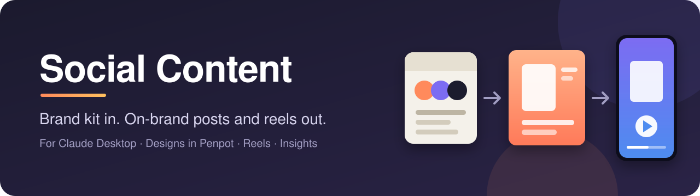
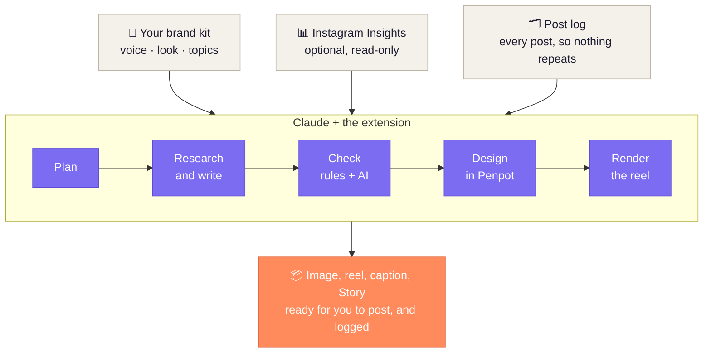

<p align="center">
  
</p>

<p align="center">
  <a href="https://github.com/Kwhite76/social-content-mcp/releases/latest"></a>
  <a href="https://github.com/Kwhite76/social-content-mcp/actions/workflows/ci.yml"></a>
  
  
  
</p>

<p align="center">
  <a href="guides/getting-started.md"><b>Setup guide</b></a> ·
  <a href="https://github.com/Kwhite76/social-content-mcp/releases/latest"><b>Download</b></a> ·
  <a href="#-how-it-works">How it works</a> ·
  <a href="#-for-developers">Developers</a> ·
  <a href="docs/PLAN.md">Plan and status</a>
</p>

---

**Social Content** is a Claude Desktop extension that turns your brand into a steady run of social
posts. Describe your brand once in a short interview. After that, ask for a batch and Claude plans
a post for each day, fact-checks it, writes it in your voice, designs the image in your Penpot,
animates it into a 20 to 30 second reel, and logs it so nothing repeats. Connect Instagram and each
batch learns from what your recent posts did.

It has no brand of its own: everything that makes posts yours lives in your brand kit.

> [!NOTE]
> It never posts for you. You review everything and post it yourself.

## ✨ What you get for every post

<table>
  <tr>
    <td width="33%" valign="top"><b>🖼️ A post image</b><br>1080×1350, built as an editable design in your Penpot file, in your colors, fonts and layouts.</td>
    <td width="33%" valign="top"><b>🎬 A 20–30 s reel</b><br>1080×1920 in one of 14 motion styles, with close-ups, short notes in your style and your logo at the end.</td>
    <td width="33%" valign="top"><b>✍️ A caption in your voice</b><br>Checked against your writing rules, and scored by the built-in AI-writing check until it reads as yours.</td>
  </tr>
  <tr>
    <td valign="top"><b>📱 A Story version</b><br>With a poll, quiz, slider or question sticker to get replies.</td>
    <td valign="top"><b>💬 Comment kit</b><br>A pinned first comment and reply templates for the comments you'll get.</td>
    <td valign="top"><b>🔎 Sources and music</b><br>A source for every fact, plus sound ideas to search for in Instagram.</td>
  </tr>
</table>

## 🧭 How it works



| Piece | What it does |
|---|---|
| **The extension** | Gives Claude the tools to plan, design, render and log posts. Runs on your computer inside Claude Desktop. |
| **Your brand kit** | A folder holding your logo, example posts, voice, colors, fonts, topics and formats. The setup interview writes it for you. |
| **Penpot** | Free online design tool. Every image is a real design you can tweak by hand. |
| **The keeper** | Keeps a hidden Penpot page open and connected, and reconnects it if it drops. Starts and stops with the extension. |
| **AI-writing check** | A built-in detector scores every caption sentence by sentence; anything that reads as AI-written gets reworded. Required, and it runs locally. |
| **Instagram Insights** | Optional. Reads reach, saves, shares and watch time for your recent posts so batches lean toward what works. Never posts or changes anything. |

## 🚀 Get started

1. **Download** the file for your computer from the [latest release](https://github.com/Kwhite76/social-content-mcp/releases/latest):

   | Computer | File |
   |---|---|
   | Windows | `social-content-mcp-<version>-win32-x64.mcpb` |
   | Mac with Apple Silicon (M1 and later) | `…-darwin-arm64.mcpb` |
   | Intel Mac | `…-darwin-x64.mcpb` |
   | Linux | `…-linux-x64.mcpb` |

2. **Double-click it** to install in Claude Desktop, and pick an empty folder for your brand kit.
3. **In Claude, choose the `setup` prompt.** Claude connects Penpot, interviews you about your
   brand, and offers to connect Instagram and make a test post.

The **[setup guide](guides/getting-started.md)** walks through every step and explains each setting.

<details>
<summary><b>What's required and what's optional</b></summary>
<br>

| Required | Optional |
|---|---|
| Claude Desktop, and Chrome or Edge | Instagram Insights |
| About 3 GB of free disk space (the AI check's model is 1.7 GB, downloaded once) | Example posts (designs follow your written look without them) |
| A free Penpot account, a design file and its MCP key (can be added after install) | Past captions (the voice starts generic without them) |
| A logo as a transparent PNG | Background photos |
| The setup interview: name, voice, topics, formats, look | Your own fonts (Inter, Kalam and Gochi Hand are built in) |

</details>

## 🧰 What's inside

| Area | Tools |
|---|---|
| 📘 **Guides** | `setup` (first-time setup, as an interview), `create_posts` (a batch), `connect_instagram`; as prompts and through `get_guide` |
| 🎨 **Brand kit** | `init_brand_kit`, `analyze_brand_kit`, `save_brand_kit`, `add_brand_file` (a file, a whole folder or a link; shows previews of images) |
| 🗓️ **Planning and writing** | `plan_batch`, `check_batch_plan` (repeat rules), `check_caption` (your writing rules) |
| 🤖 **AI-writing check** | `detect_ai_text`, `ai_detector_status` |
| 🗂️ **History** | `log_post`, `query_history` |
| 📊 **Instagram** | `get_insights` (read-only) |
| 🖌️ **Penpot** | `penpot_status`, `penpot_execute`, `penpot_upload_image`, `render_post` |
| 🎬 **Reels** | `render_reel` (14 motion styles) |
| 🔌 **Keeper** | `keeper_start`, `keeper_status` |

## 🎨 The brand kit

```text
My Brand Kit/
├── brand.yaml       name, voice, writing rules, look, reel note style
├── pillars.yaml     topics, formats and angles, backgrounds, layouts, repeat rules
├── logo/            your logo (transparent PNG)
├── style/           example posts you love
├── assets/          photos and backgrounds
├── voice/           past captions and writing notes
├── fonts/           your own fonts (optional)
├── history.jsonl    every post, written by the extension
├── insights/        Instagram pulls
└── output/          finished images, reels and check frames
```

You never have to edit these by hand, though you can. The
[reference](guides/getting-started.md#10-reference) explains every setting.

## 🔒 Privacy

- **Local first.** Reels and the AI-writing check run on your computer. Nothing is uploaded except
  the designs you build in your own Penpot.
- **Read-only Instagram.** The extension reads Insights and never posts, comments, likes, follows
  or changes a setting.
- **Secrets stay in your keychain.** Claude Desktop stores the Penpot key and Instagram token in
  your computer's secure storage.

---

## 🛠 For developers

<details>
<summary><b>Build a bundle</b></summary>
<br>

The canvas and ffmpeg binaries are per platform, so each bundle is built for one:

```
npm install
npm run pack                          # this computer's platform
npm run pack -- --target darwin-x64   # or another (packaging only)
```

</details>

<details>
<summary><b>Releases</b></summary>
<br>

Bump the version in `package.json` and `manifest.json`, then push a tag `vX.Y.Z` (or run the
Release workflow from the Actions tab). It builds, tests and smoke-tests every platform's bundle
and attaches them to the GitHub release. The AI detector's model has its own release,
`detector-model-vN`, built by the Detector model workflow; it only needs rebuilding when the model
changes.

</details>

<details>
<summary><b>Penpot keeper</b></summary>
<br>

Penpot's MCP plugin only works while its browser tab is awake. The keeper opens Penpot in its own
Chrome or Edge window that is never put to sleep, keeps your file open and reconnects MCP whenever
it drops.

The extension starts it with the server, in a worker thread, restarts it if it crashes, and closes
its browser when Claude Desktop quits or the extension is turned off. Every 30 seconds it checks
Penpot's MCP menu, and every minute it makes a real test call through Penpot's MCP: the menu can
say connected while the plugin has stopped answering, so two failed test calls in a row restart
the browser. If a tool's Penpot call fails because the plugin is disconnected or stalled, the
server asks the keeper to reconnect (a `RECONNECT` file), waits for a fresh connection and retries
once. Only one keeper runs per computer (`keeper.lock`); to run it by hand instead, turn Auto-start
keeper off and run:

```
npx social-content-mcp keeper
```

First run: sign in to Penpot in the window that opens and open your design file; it's remembered
(`keeper_status` reports `needs_sign_in` until then). From then on the keeper runs headless (no
window), so Windows never treats Penpot as a background tab to freeze; if Penpot ever asks you to
sign in again, a window opens for that. A watchdog restarts the browser if the page stops
responding. `KEEPER_HEADED=1` keeps the window. Files live in `~/.social-content-mcp/keeper` (log,
settings, `PAUSE` file to pause it).

</details>

<details>
<summary><b>Reels</b></summary>
<br>

`render_reel` draws with Skia (`@napi-rs/canvas`) and encodes with a bundled ffmpeg, so nothing
else needs installing. Frames are rendered in 2-second segments by up to 6 worker threads in
parallel (one per spare core, limited by free memory) and joined byte for byte (raw H.264, no
B-frames), which keeps every frame and keeps memory flat: the canvas binding never returns the
memory of pixel reads, so each segment's thread exits and the memory is reused. Threads, not
subprocesses, because Claude Desktop's built-in Node can't start Node subprocesses.

</details>

<details>
<summary><b>AI-writing check</b></summary>
<br>

`detect_ai_text` runs desklib/ai-text-detector-v1.01 (MIT; DeBERTa-v3-large, mean pooling, one
logit) locally and scores like houtini-ai/ai-detect: split after `.`, `!` or `?` plus whitespace,
skip sentences under 5 words, sigmoid per sentence, mean as a percentage. It's required: every
caption is scored, and `log_post` needs the score.

- **Model:** converted to ONNX by the Detector model workflow (`scripts/detector/export.py`), which
  then runs `scripts/detector/parity.ts`: the Node tokenizer must match Python's token ids exactly
  and the fp32 model must match PyTorch within 0.01 on `scripts/detector/samples.json`; the int8
  model ships if it stays within 0.05 with no sentence changing sides of 0.5, else fp32. The files
  and the parity report go on the `detector-model-v1` release. Push a `detector-model-vN` tag to
  rebuild (and update the release name in `src/detect/detector.ts`).
- **Download:** about 1.7 GB, once, on first use (or `ai_detector_status` with `download: true`),
  checked against the manifest's SHA-256, kept in `~/.social-content-mcp/models`.
- **Runtime:** onnxruntime-node, or onnxruntime-web's WebAssembly build where there's no native
  binary (Intel Macs); same scores. `.npmrc` skips onnxruntime-node's optional CUDA download.
  Bundles keep only their platform's native binaries and the one wasm build.
- **Tests:** `tests/fixtures/detector` is a stand-in DeBERTa-v3-style tokenizer and tiny ONNX model
  with Python's token ids and scores, so the tokenizer, truncation at 512 tokens, both runtimes,
  the download and the checksum are all tested without the real model.

</details>

<details>
<summary><b>Develop and test</b></summary>
<br>

```
npm install
npm run build
npm test                 # unit + MCP integration tests
KEEPER_E2E=1 npm test    # also runs the keeper against a mock Penpot (needs Chrome or Edge)
REEL_E2E=1 npm test      # also encodes a reel end to end (run npm run build first)
npm run bench:reel       # times a ~29 s reel on this machine
npm run spike:penpot     # with SCM_PENPOT_MCP_KEY set: checks the key reaches Penpot
```

Settings (environment variables, filled in by the .mcpb settings screen; an unfilled
`${user_config.x}` placeholder counts as empty):
`SCM_BRAND_KIT_DIR`, `SCM_PENPOT_MCP_KEY`, `SCM_PENPOT_URL`, `SCM_INSTAGRAM_TOKEN`,
`SCM_INSTAGRAM_ACCOUNT_ID`, `SCM_AUTO_KEEPER`, `SCM_OUTPUT_DIR`.

For tests: `SCM_STATE_DIR` (moves `~/.social-content-mcp`; don't change HOME/USERPROFILE, which
Chrome on Windows needs), `SCM_INSTAGRAM_API_BASE`, `SCM_DETECTOR_URL`, `SCM_DETECTOR_DIR`,
`SCM_DETECTOR_RUNTIME=wasm`, `KEEPER_PROBE_TICKS`.

</details>
